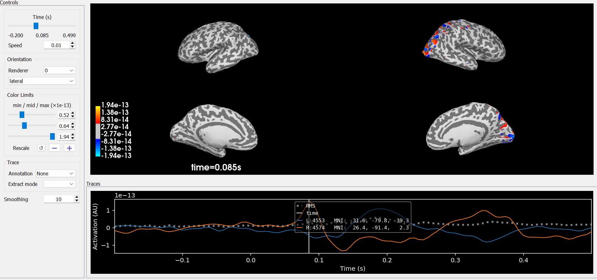
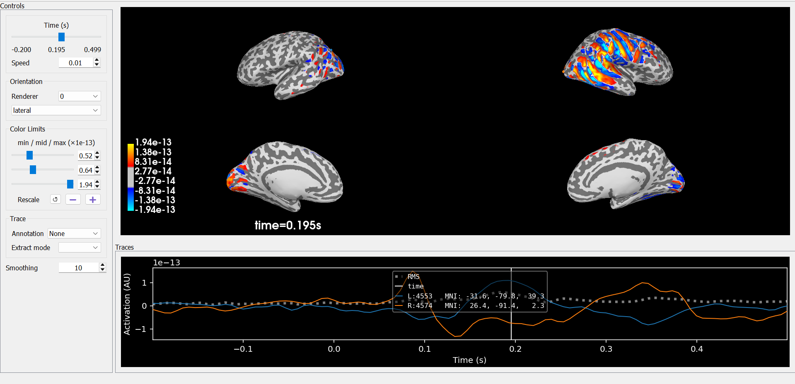
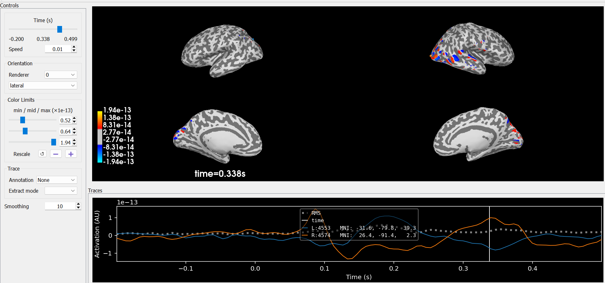
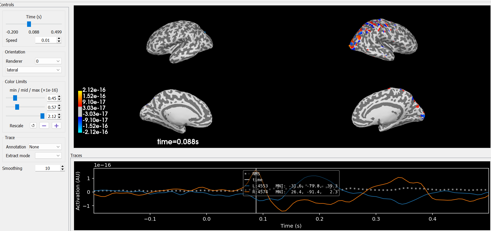
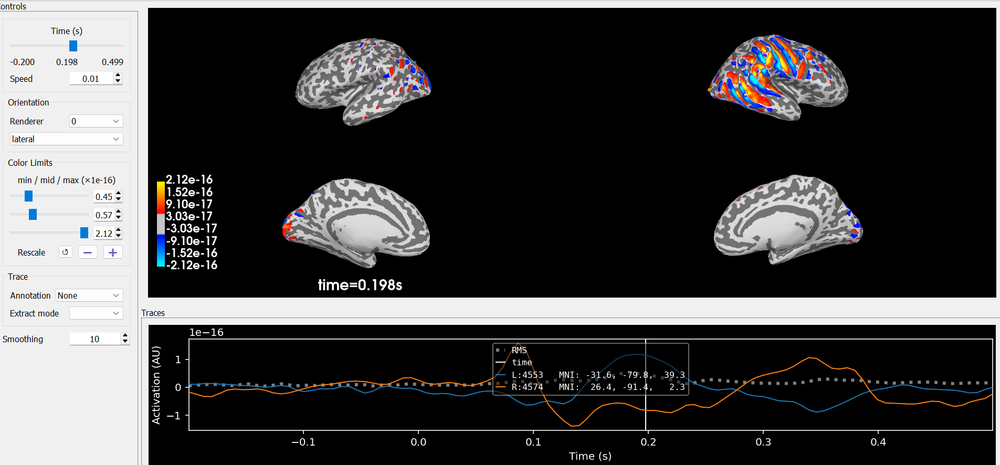
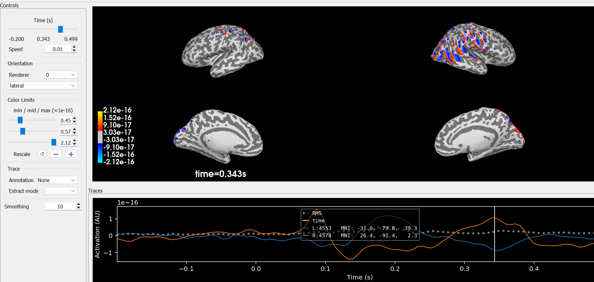
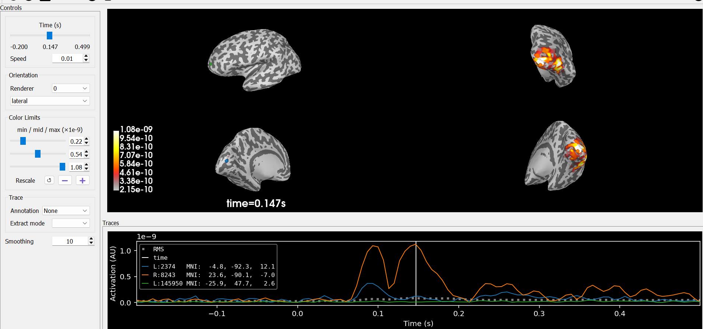
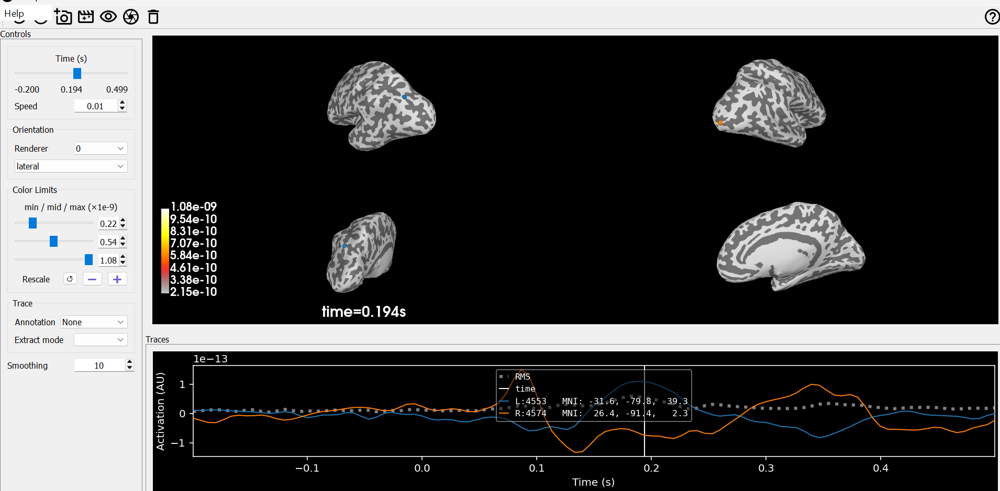
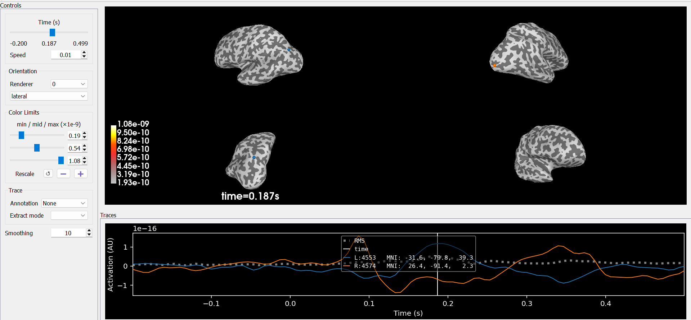

# MEG Source Localization — MNE and Woodbury Solvers

**Academic Project | Signal Processing · Inverse Problems · Neuroimaging**

Master's coursework project developed in Signal and Image Processing at Aix-Marseille Université, France.

This project investigates **magnetoencephalography (MEG) source localization** using the MNE-Python sample dataset.

It explores classical minimum-norm inverse methods and implements custom numerical solvers based on the **Woodbury formulation**, including Minimum Norm Estimation (MNE) and weighted Minimum Norm Estimation (wMNE).

The project also investigates dSPM/sLORETA-inspired normalization methods and cortical source visualization.

## Project Objectives

The main objectives are:

- Process MEG recordings and extract event-related responses.
- Understand the mathematical formulation of the MEG inverse problem.
- Implement minimum-norm source reconstruction algorithms.
- Explore depth-weighted regularization.
- Compare custom inverse solutions with MNE-Python reference methods.
- Visualize reconstructed cortical activity over time.

## Mathematical Background

MEG source localization is an ill-posed inverse problem.

The forward model is written as:

\[
Z = GS + N
\]

where:

- \(Z\): measured MEG sensor signals
- \(G\): forward operator (leadfield matrix)
- \(S\): unknown cortical source activity
- \(N\): measurement noise

### Minimum Norm Estimation (MNE)

The regularized minimum-norm solution can be expressed as:

\[
\hat{S} =
G^T(GG^T+\lambda I)^{-1}Z
\]

where \(\lambda\) is a regularization parameter.

This sensor-space formulation is useful when the number of sources is substantially larger than the number of sensors.

### Weighted Minimum Norm Estimation (wMNE)

A weighted formulation introduces a source-space weighting matrix \(W\):

\[
\hat{S} =
WG^T(GWG^T+\lambda I)^{-1}Z
\]

Depth weighting is used to compensate for differences in source sensitivity related to cortical location.

The exact solution depends on the choice of source priors, noise modeling, regularization and orientation constraints.

## Technical Stack

- **Programming:** Python
- **MEG Processing:** MNE-Python
- **Numerical Computing:** NumPy, SciPy
- **Machine Learning Utilities:** scikit-learn
- **Visualization:** Matplotlib, MNE 3D visualization
- **Development:** Jupyter Notebook, VS Code, Git
- **Dataset:** MNE-Python Sample Dataset

## Processing Workflow

The notebook implements the following processing stages:

1. Load the MNE sample MEG recording and auditory/visual events.
2. Fit Independent Component Analysis (ICA) for artifact inspection.
3. Segment the signals into epochs.
4. Compute auditory and visual evoked responses.
5. Apply reference inverse solutions using MNE-Python.
6. Load the forward operator and align the MEG channels.
7. Extract the observations and leadfield matrix.
8. Compute custom MNE and wMNE solutions using sensor-space systems.
9. Explore source normalization approaches.
10. Visualize reconstructed cortical activity.

## Cortical Source Reconstruction

The following figures illustrate cortical source reconstructions obtained during the academic experiments.

They display the spatial distribution of estimated source activity at selected time points following stimulation.

The images include lateral and medial cortical views, along with temporal traces of selected source estimates.

### Reconstruction Series A

The following images illustrate the evolution of reconstructed cortical activity at three time points.

**85 ms after stimulation**



**195 ms after stimulation**



**338 ms after stimulation**



### Reconstruction Series B

A second series illustrates source reconstruction with different numerical amplitudes and spatial activation patterns.

**88 ms after stimulation**



**198 ms after stimulation**



**343 ms after stimulation**



### Additional Reconstruction Visualizations

Additional cortical maps were obtained to explore different reconstruction configurations.

**Comparison 1**



**Comparison 2**



**Comparison 3**



### Interpretation

The cortical maps illustrate the spatial and temporal variability of reconstructed MEG source activity.

Several observations can be made:

- Estimated source activity evolves over time following stimulation.
- Different reconstruction configurations produce different spatial activation patterns.
- Source amplitudes and spatial distributions depend on the inverse method and its regularization.
- Cortical visualizations provide a qualitative representation of the reconstructed activity.

**Important:** The two reconstruction series use different numerical scales. Direct comparison of their color intensities is therefore not appropriate without additional normalization.

The method-to-figure correspondence should be checked against the original notebook before drawing quantitative conclusions.

## Custom Inverse Solvers

In addition to MNE-Python reference routines, the notebook includes custom numerical implementations.

### Custom MNE

The custom solver computes a regularized minimum-norm estimate using a sensor-space linear system.

This avoids explicitly inverting a large source-space matrix.

### Custom wMNE

The weighted solver incorporates source-dependent weighting into the inverse formulation.

The objective is to investigate the effect of depth weighting on reconstructed cortical activity.

### Numerical Comparison

The custom solvers are compared qualitatively with MNE-Python source reconstructions.

However, the implementations do not necessarily share identical:

- Noise covariance modeling
- Whitening conventions
- Regularization parameters
- Source orientation constraints
- Source prior assumptions
- Normalization procedures

Consequently, numerical equivalence with MNE-Python inverse routines is not claimed.

## Project Structure

```text
meg-source-localization/
│
├── notebooks/
│   └── meg_source_localization.ipynb
│
├── docs/
│   └── figures/
│       └── cortical_maps/
│           ├── mne_temporal_085ms.png
│           ├── mne_temporal_195ms.png
│           ├── mne_temporal_338ms.png
│           ├── wmne_temporal_088ms.png
│           ├── wmne_temporal_198ms.png
│           ├── wmne_temporal_343ms.png
│           ├── comparison_01.png
│           ├── comparison_02.png
│           └── comparison_03.png
│
├── README.md
├── requirements.txt
└── .gitignore
```

## Installation

### 1. Clone the repository

```bash
git clone https://github.com/EBL-svg/meg-source-localization.git

cd meg-source-localization
```

The repository must be accessible to your GitHub account if it is still private.

### 2. Create a Python environment

Python 3.11 is recommended.

**Windows PowerShell:**

```powershell
py -3.11 -m venv .venv
.\.venv\Scripts\Activate.ps1
```

**Linux/macOS:**

```bash
python3.11 -m venv .venv
source .venv/bin/activate
```

### 3. Install dependencies

```bash
python -m pip install --upgrade pip

python -m pip install -r requirements.txt
```

If necessary, install JupyterLab separately:

```bash
python -m pip install jupyterlab
```

The notebook uses scikit-learn for FastICA through MNE-Python.

### 4. Run the notebook

Open:

`notebooks/meg_source_localization.ipynb`

You can use VS Code with the Jupyter extension or JupyterLab:

```bash
python -m jupyter lab
```

Select the Python interpreter associated with the virtual environment and execute the notebook cells sequentially.

The MNE sample dataset may require a substantial initial download.

## Execution and Reproducibility

The notebook has been executed in a local Python virtual environment during repository preparation.

The processing stages and inverse reconstruction routines were run, and cortical visualizations were generated.

However, successful execution does not by itself establish numerical equivalence between the custom solvers and the MNE-Python reference methods.

### Reproducibility Considerations

- The MNE sample dataset is downloaded separately.
- ICA artifact component selection requires manual inspection.
- Source localization depends on the forward operator and its alignment with observations.
- Inverse estimates depend on regularization and source priors.
- Interactive cortical visualization requires a compatible 3D rendering environment.
- Numerical results may vary with library versions and processing configurations.

The project is intended for educational and research exploration, not clinical interpretation.

## Limitations and Future Work

The current implementation is primarily exploratory.

Potential improvements include:

- Systematic selection and validation of ICA components.
- Harmonization of whitening and regularization across inverse methods.
- Quantitative comparison of custom and reference solvers.
- Evaluation using controlled simulated source locations.
- Automated tests for forward/inverse model consistency.
- Improved reproducibility of source localization visualizations.

## Academic Context

This project was developed collaboratively during the Master's programme in Signal and Image Processing at Aix-Marseille Université, France.

**Contributors:**
- Elhadji Loukoubar
- Charbel Abou Boutros

The project focuses on mathematical modeling, numerical algorithms and source reconstruction techniques for magnetoencephalography.

## Acknowledgements

This project uses the MNE-Python ecosystem and its example MEG dataset.

The MNE-Python developers and contributors are acknowledged for providing open tools for electrophysiological data analysis.

## License

No redistribution or reuse license is granted by default.

The project may be distributed under an open-source license after confirming the relevant publication permissions for the coursework and third-party resources.
